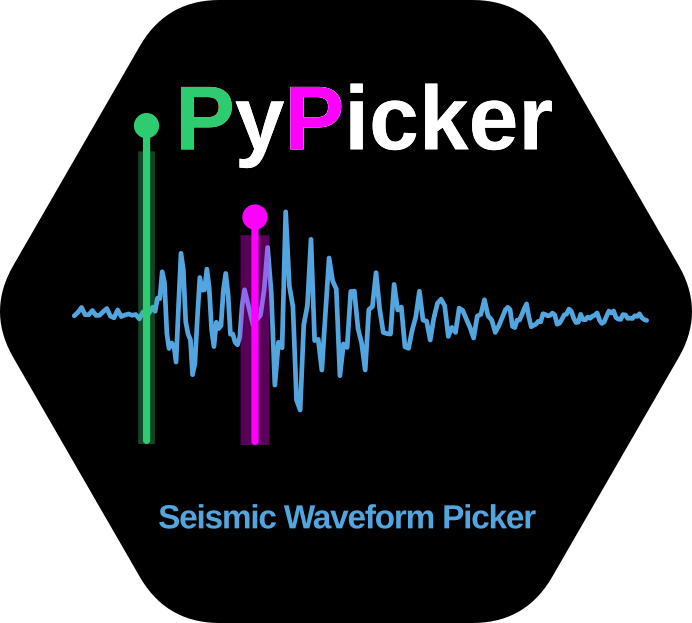
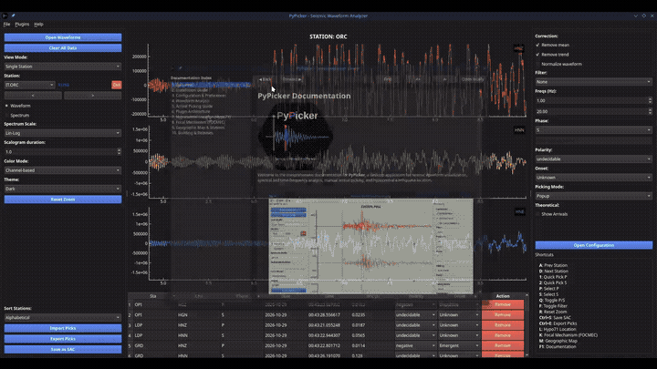

<p align="center">
  <picture>
    <source media="(prefers-color-scheme: dark)" srcset="doc/icon/PyPicker_logo_dark.png">
    <source media="(prefers-color-scheme: light)" srcset="doc/icon/PyPicker_logo_white.png">
    
  </picture>
</p>

<p align="center">
  <a href="https://doi.org/10.5281/zenodo.21976300"></a>
  <a href="./LICENSE"></a>
  <a href="https://www.python.org/"></a>
</p>

<p align="center">
  <b>PyPicker</b> is a modern, high-performance Python desktop application for seismic waveform visualization, frequency and time-frequency analysis, manual arrival picking, hypocentral earthquake location, and interactive station mapping.
</p>

<p align="center">
  
</p>

<p align="center">
  <sub>🎬 <i>Full-resolution demonstration video available in <a href="doc/images/PyPicker_use.mp4"><code>doc/images/PyPicker_use.mp4</code></a></i></sub>
</p>

---

## Key Features

- **Multi-Format Waveform Support**: Load SAC, MiniSEED, and all formats readable by ObsPy.
- **Flexible Display Modes**: Single Station, All Stations, and Focus Mode.
- **Focus Mode & Time-Frequency Scalograms**: Compare raw traces, filtered waveforms, and continuous Morlet scalograms with synchronized time axes.
- **Signal Preprocessing**: Demean, linear detrend, station-shared normalization, and Butterworth band-pass, low-pass, and high-pass filtering.
- **Accurate Arrival Picking**: Manual and instant hotkey picking (`1` for P, `2` for S) with interactive uncertainty intervals ($\pm \Delta t$), polarities, and onsets.
- **Integrated Hypo71 Location (`hypo71py`)**: Solve for earthquake hypocenter coordinates, origin time, RMS, and phase residuals directly from picks using a 1D crustal velocity model.
- **Focal Mechanism Inversion (FOCMEC)**: Solve for double-couple fault planes (Strike, Dip, Rake), kinematic P/T axes, and tectonic regime using P-wave polarities via grid search, with interactive beachball stereonet display and CSV export.
- **Coherent Theoretical Arrivals**: Shared 1D velocity structure between Hypo71 and ObsPy TauP theoretical arrival curves.
- **Interactive Geographic Map**: Cartopy-powered map with DEM relief, transparency control, FDSN station inventory (INGV), and live epicenter tracking.
- **Protected File Writing**: Save relocated SAC files with `_hypo71` suffix into `h71_localized/` without modifying original files.
- **Pick Import & Export**: Full compatibility with CSV, QuakeML, and SeisGram2K `.pick` formats.
- **Customizable Environment**: Configurable shortcuts and colors via persistent user configuration (`~/.config/PyPicker/`).

---

## Quick Start

### 1. Download Precompiled Binaries
Standalone packages and system packages are available on [GitHub Releases](https://github.com/DonatoTalone/PyPicker/releases):
- **Linux**: Standalone `.zip` or packages for Debian/Ubuntu (`.deb`), Fedora/RHEL (`.rpm`), and Arch Linux (`.pkg.tar.zst`).
- **Windows**: Standalone `.zip` with `PyPicker.exe`.
- **macOS**: Standalone `.zip` containing `PyPicker.app` (Apple Silicon and Intel).

### 2. Install from Source

```bash
git clone --branch dev https://github.com/DonatoTalone/PyPicker.git
cd PyPicker

python -m venv .venv
source .venv/bin/activate  # On Windows: .venv\Scripts\activate

python -m pip install -r requirements.txt
python -m pip install -e .
```

Launch PyPicker from any directory:
```bash
pypicker
```
*(Or run `python seismic_picker_qt.py` directly).*

---

## Default Shortcuts

Shortcuts can be customized in `~/.config/PyPicker/config.json`.

| Shortcut | Action |
| --- | --- |
| `1` / `2` | Instant P / S pick at mouse cursor position |
| `A` / `D` | Previous / next station |
| `P` / `S` | Select P / S phase mode |
| `C` | Select custom phase |
| `Q` | Toggle between P and S |
| `R` | Reset zoom / pan |
| `F` | Toggle filtering on / off |
| `L` | Open Hypo71 Earthquake Location dialog |
| `M` | Open Geographic Map (DEM, stations & epicenter) |
| `Ctrl+S` | Save picks to SAC headers |
| `Ctrl+E` | Export picks (CSV / QuakeML) |

---

## Documentation

Full, detailed documentation is available in the [`doc/`](./doc/) directory:

- [**Documentation Overview**](./doc/README.md)
- [**Installation Guide**](./doc/installation.md) — Precompiled packages, Linux distributions, macOS, Windows, and virtual environments.
- [**Configuration & Preferences**](./doc/configuration.md) — Directory layout, user overrides, `config.json`, and `velocity_model.json`.
- [**Waveform Analysis & Visualization**](./doc/waveform_analysis.md) — View modes, spectra, normalization, filtering, and Morlet scalograms.
- [**Plugin System & Architecture**](./doc/plugin_system.md) — Modular plugin model, directory layout, UI integration, and developing custom plugins.
- [**Hypocentral Earthquake Location**](./doc/hypo71_localization.md) — Geiger's method, 1D crustal velocity models, Trial Depth ($Z_{TR}$), residuals, and saving to `h71_localized/`.
- [**Earthquake Focal Mechanism**](./doc/focmec_focal_mechanism.md) — Double-couple point sources, Aki & Richards convention, P-wave polarities, FOCMEC grid search, and stereographic beachball visualization.
- [**Geographic Map & Seismic Stations**](./doc/geographic_map.md) — Interactive Cartopy map, DEM relief in transparency, FDSN station catalog (INGV), and live epicenter tracking.
- [**Building & Releases**](./doc/building_and_release.md) — Compiling executables with PyInstaller and the GitHub Actions CI/CD matrix.

---

## Project Structure

```text
seismic_picker_qt.py       GUI application, plotting, and picking interaction
picker_utils_qt.py         Configuration syncing, preprocessing, and pick I/O
config/                    Configuration templates, velocity models, and plugins
├── config.json            Default user preferences
├── velocity_model.json    Default 1D crustal velocity model (Hypo71 + TauP)
├── picker_utils_qt.py     Reference copy of utilities
└── plugins/               Integrated plugins (hypo71py, focmecpy, map)
doc/                       Comprehensive project documentation
examples/                  Example waveform datasets (Campi Flegrei, USGS Japan)
pyproject.toml             Package build and CLI entry-point configuration
requirements.txt           Pinned Python dependencies
PyPicker.spec              PyInstaller build definition
.github/workflows/         Automated multi-platform release CI/CD
CITATION.cff               Citation metadata
LICENSE                    GNU General Public License v3
```

---

## Citation & License

If you use PyPicker in scientific research, please cite it using the metadata in [`CITATION.cff`](./CITATION.cff) and DOI [10.5281/zenodo.21976300](https://doi.org/10.5281/zenodo.21976300).

### Third-Party Software & Acknowledgments

- **hypo71py**: Kris Vanneste and Dan Sandiford, Python implementation of the HYPO71 earthquake location algorithm ([earthquake-research-group/hypo71py](https://github.com/earthquake-research-group/hypo71py)), based on Lee & Lahr (1972, 1975).
- **FOCMEC / SurfQuake**: Arthur Snoke (1984, 2003) and Roberto Cabieces et al. ([ProjectISP / SurfQuake](https://projectisp.github.io/surfquaketutorial.github.io/focmec/)).

The code is developed with the help of AI models: Gemini 3.6 Flash (High) Antigravity, GPT6.1 Sol (Reasoning), Claude Sonnet 5.5 (Extra).

PyPicker is released under the [GNU General Public License v3](./LICENSE).
