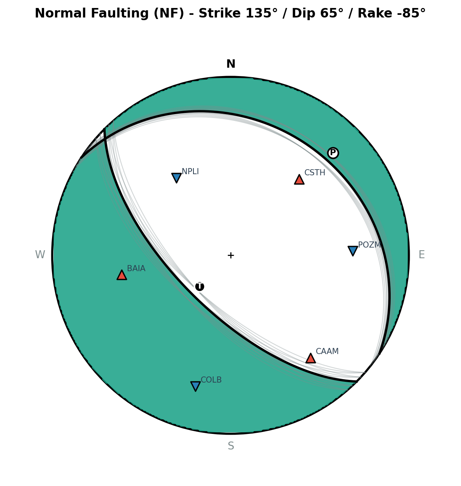

# Earthquake Focal Mechanism Determination with FOCMEC

PyPicker integrates the classical, seismological standard **FOCMEC** algorithm (Snoke et al., 1984; Snoke, 2003) for determining and displaying double-couple earthquake focal mechanisms from P-wave first-motion polarities, in accordance with the workflow developed in [SurfQuake](https://projectisp.github.io/surfquaketutorial.github.io/focmec/) and [ProjectISP](https://projectisp.github.io/ISP_tutorial.github.io/). This guide details the mathematical principles, solver parameters, radiation patterns, kinematic faulting regimes, stereographic beachball visualization, and complete CSV report exporting.

---

## 1. Principles & Mathematical Formulation

Earthquake focal mechanisms describe the geometry of fault slip at the earthquake source during seismic rupture. In the point-source approximation, shear dislocation along a planar fault is equivalent to an internal **double-couple** force system without net torque.

### The Double-Couple Point Source

Following the standard seismological convention of **Aki & Richards (1980 / 2002)**, the orientation of a fault plane is defined by three angles:
- **Strike ($\phi_s$)**: Azimuth of the fault trace relative to North, measured clockwise in $[0^\circ, 360^\circ)$. The fault plane dips to the right of the strike direction.
- **Dip ($\delta$)**: Angle between the fault plane and the horizontal surface, measured downward in $[0^\circ, 90^\circ]$.
- **Rake ($\lambda$)**: Slip direction of the hanging wall relative to the footwall, measured in the fault plane in $[-180^\circ, 180^\circ]$:
  - $\lambda = 0^\circ$: Pure left-lateral strike-slip
  - $\lambda = 180^\circ$ (or $-180^\circ$): Pure right-lateral strike-slip
  - $\lambda = 90^\circ$: Pure reverse / thrust faulting
  - $\lambda = -90^\circ$: Pure normal faulting

In Cartesian coordinates where $x_1 = \text{North}$, $x_2 = \text{East}$, and $x_3 = \text{Down}$ (Aki & Richards, 1980):
- **Unit fault normal vector $\mathbf{n}$** (pointing into the hanging wall):
  \[
  \mathbf{n} = \begin{bmatrix} -\sin\delta \sin\phi_s \\ \sin\delta \cos\phi_s \\ -\cos\delta \end{bmatrix}
  \]
- **Unit slip vector $\mathbf{u}$** (direction of hanging wall motion):
  \[
  \mathbf{u} = \begin{bmatrix} \cos\lambda \cos\phi_s + \cos\delta \sin\lambda \sin\phi_s \\ \cos\lambda \sin\phi_s - \cos\delta \sin\lambda \cos\phi_s \\ -\sin\delta \sin\lambda \end{bmatrix}
  \]

### P-Wave Radiation Pattern on the Focal Sphere

A seismic ray leaves the hypocenter towards a recording station in a direction characterized by:
- **Azimuth ($\alpha$)**: Clockwise from North in $[0^\circ, 360^\circ)$.
- **Take-off angle ($i$)**: Angle measured from the downward vertical (nadir) in $[0^\circ, 180^\circ]$ ($0^\circ$ = straight down, $90^\circ$ = horizontal, $>90^\circ$ = upgoing ray).

The unit ray vector leaving the source is:
\[
\mathbf{r} = \begin{bmatrix} \sin i \cos\alpha \\ \sin i \sin\alpha \\ \cos i \end{bmatrix}
\]

The theoretical P-wave radiation amplitude factor $A_P$ is the scalar product:
\[
A_P = (\mathbf{n} \cdot \mathbf{r})(\mathbf{u} \cdot \mathbf{r})
\]
Expanded analytically (Aki & Richards, 1980; Snoke, 2003):
\[
A_P = \cos\lambda \sin\delta \sin^2 i \sin 2(\alpha - \phi_s) - \cos\lambda \cos\delta \sin 2i \cos(\alpha - \phi_s) + \sin\lambda \sin 2\delta (\cos^2 i - \sin^2 i \sin^2(\alpha - \phi_s)) + \sin\lambda \cos 2\delta \sin 2i \sin(\alpha - \phi_s)
\]

### First-Motion Polarity Convention

- If $A_P > 0$, the first motion is **Compressional (Up / C / $+1$)**: first pulse on the vertical component is upward.
- If $A_P < 0$, the first motion is **Dilatational (Down / D / $-1$)**: first pulse on the vertical component is downward.
- If $A_P = 0$, the ray lies exactly on one of the two **nodal planes** ($\mathbf{n} \cdot \mathbf{r} = 0$ or $\mathbf{u} \cdot \mathbf{r} = 0$).

---

## 2. Solver Parameters: Systematic Grid Search

FOCMEC (Snoke, 1984, 2003) finds double-couple solutions through an exhaustive **grid search** over the orientation space $(\phi_s, \delta, \lambda)$:

```text
FOCMEC Parameters
[ Grid Step (Δ): [  5.0 ° ]  ]   [ Accepted Misfits: [ 1 ]  ]
[x] Show all acceptable nodal planes   [x] Plot station polarities on beachball
```

### Grid Resolution ($\Delta$)
The orientation space is discretized:
- $\phi_s \in [0^\circ, 360^\circ)$ with step $\Delta$
- $\delta \in [\Delta, 90^\circ]$ with step $\Delta$
- $\lambda \in [-180^\circ, 180^\circ)$ with step $\Delta$

For $\Delta = 5^\circ$, the grid evaluates $72 \times 18 \times 72 = 93,312$ candidate mechanisms in under 0.2 seconds via vectorized NumPy operations. A finer step $\Delta = 2^\circ$ evaluates $1.45 \times 10^6$ orientations for higher precision.

### Accepted Misfits (`max_errors`)
> [!IMPORTANT]
> **Accepted Misfits is the number of discrepant station polarities tolerated by the inversion.**
> Following SurfQuake's default (`-a 1.0`), allowing 1 misfit accounts for local site noise, weak signal-to-noise ratio, or emergent phase arrivals without rejecting the true tectonic solution.

For each grid point, the number of polarities with opposite theoretical sign is counted:
\[
N_{\text{misfit}} = \sum_{k=1}^{N_{\text{sta}}} \mathbb{I}\left( \text{sign}(A_{P,k}) \neq p_{\text{obs},k} \right)
\]
All solutions satisfying $N_{\text{misfit}} \le N_{\text{accepted}}$ are retained as the **acceptable solution set**.

---

## 3. Kinematic Axes & Faulting Regimes

### Auxiliary Nodal Plane
Because double couples possess intrinsic symmetry ($\mathbf{n} \leftrightarrow \mathbf{u}$), a focal mechanism solution always yields two orthogonal planes:
- **Primary Nodal Plane 1**: $(\phi_{s1}, \delta_1, \lambda_1)$ with normal $\mathbf{n}_1$ and slip $\mathbf{u}_1$.
- **Auxiliary Nodal Plane 2**: $(\phi_{s2}, \delta_2, \lambda_2)$ with normal $\mathbf{n}_2 = \mathbf{u}_1$ and slip $\mathbf{u}_2 = \mathbf{n}_1$.

### Kinematic Stress Axes (P, T, B)
The principal axes of strain and stress:
- **Pressure Axis ($\mathbf{P}$)**: Bisector of the dilatational quadrant:
  \[
  \mathbf{P} = \frac{\mathbf{n} - \mathbf{u}}{\sqrt{2}}
  \]
- **Tension Axis ($\mathbf{T}$)**: Bisector of the compressional quadrant:
  \[
  \mathbf{T} = \frac{\mathbf{n} + \mathbf{u}}{\sqrt{2}}
  \]
- **Null Axis ($\mathbf{B}$)**: Intersection line of the two nodal planes ($\mathbf{B} = \mathbf{n} \times \mathbf{u}$).

Each axis is reported as **Trend** (horizontal azimuth in $[0^\circ, 360^\circ)$) and **Plunge** (inclination below horizontal in $[0^\circ, 90^\circ]$).

### Tectonic Regime Classification
PyPicker classifies the focal mechanism following the standard ternary plunge criteria of **Frohlich (1992)** and **Zoback (1992)**:
- **Normal Faulting (NF)**: P-axis plunge $\ge 52^\circ$
- **Thrust / Reverse Faulting (TF)**: T-axis plunge $\ge 52^\circ$
- **Strike-Slip Faulting (SS)**: B-axis plunge $\ge 52^\circ$
- **Oblique Normal (NS)**: Intermediate P and B plunges
- **Oblique Thrust (TS)**: Intermediate T and B plunges

---

## 4. 1D Crustal Velocity Model & Take-Off Angles

PyPicker preserves strict kinematic coherence between location and focal mechanisms:
- Station take-off angles ($i$) are calculated dynamically from the same 1D crustal model ([`config/velocity_model.json`](../config/velocity_model.json)) using **ObsPy TauP**.
- For upgoing rays ($i > 90^\circ$) common at close epicentral distances ($R_{\text{epi}} < 2Z$), the ray is mapped to the lower focal hemisphere through the antipodal point:
  \[
  i_{\text{lower}} = 180^\circ - i, \quad \alpha_{\text{lower}} = (\alpha + 180^\circ) \pmod{360^\circ}
  \]
  ensuring standard, unambiguous lower-hemisphere stereonet projection.

---

## 5. Prerequisites for Inversion

To calculate an earthquake focal mechanism:
1. **Hypocenter Coordinates**: Event coordinates (`evla`, `evlo`, `evdp`) must be loaded from SAC headers or generated by running **Hypo71 localization** (`L`).
2. **Station Polarities**:
   - At least **4 P-wave arrivals** with clear polarity (`positive` / `+` or `negative` / `-`).
   - For reliable focal mechanism determination, **8 to 15 stations** with azimuthal gap $< 180^\circ$ are recommended.

---

## 6. Running FOCMEC & Interpreting Results

### Workflow
1. Open the FOCMEC dialog by pressing **`K`** or selecting **Plugins → Focal Mechanism (FOCMEC) (K)**.
   - Alternatively, click **Focal Mechanism (FOCMEC)** in the Hypo71 dialog immediately after localizing an event.
2. Review the station polarities in the table. You can modify polarities on the fly using the table drop-down menus.
3. Set the **Grid Step** (default $5^\circ$) and **Accepted Misfits** (default $1$).
4. Click **Calculate Focal Mechanism (FOCMEC)**.



### Stereographic Beachball Display
The dialog displays an interactive Matplotlib canvas with an equal-area (Schmidt) lower-hemisphere projection:
- **Compressional Quadrants**: Shaded in dark cyan/teal.
- **Dilatational Quadrants**: White.
- **Primary & Auxiliary Nodal Planes**: Bold black curves.
- **Ensemble of Acceptable Solutions**: When **Show all acceptable nodal planes** is checked (SurfQuake `--all_solutions`), all acceptable fault plane arcs are drawn in semi-transparent gray, visually portraying the solution uncertainty envelope.
- **Station Polarities**:
  - Red upward triangles ($\blacktriangle$) for compressional arrivals (+).
  - Blue downward triangles ($\triangledown$) for dilatational arrivals (-).
  - Stations identified as misfits are highlighted with a prominent yellow border.
- **P and T Axes**: Letter labels placed at their respective trend and plunge.

---

## 7. Output Management & Export Formats

### Exporting Images
Click **Save Beachball Image...** to export publication-quality vector or raster figures in **PNG**, **PDF**, or **SVG** format.

### Exporting Complete CSV Report
Click **Export CSV Report...** to generate a structured `.csv` file containing:
1. Complete hypocenter location parameters (Origin Time, Lat, Lon, Depth, RMS, ERH, ERZ, Quality).
2. Focal mechanism solution (NP1 strike/dip/rake, NP2 strike/dip/rake, P/T/B trend & plunge, faulting regime).
3. Inversion statistics (polarities count, misfits count, accepted solutions count, azimuthal gap).
4. Full station breakdown table (station, azimuth, takeoff, observed polarity, calculated polarity, misfit flag).

### Interoperability with Standard FOCMEC
Click **Export FOCMEC .inp...** to save a standard 4-column FOCMEC input file (`STA`, `AZ`, `TOANG`, `SENSE`) fully compatible with Arthur Snoke's original Fortran software and SurfQuake command-line scripts (`surfquake focmec`).

### Automatic GIS Seismic Catalog (`seismic_catalog.txt`)
When **Calculate Focal Mechanism (FOCMEC)** completes:
1. PyPicker automatically logs the focal mechanism parameters directly into `seismic_catalog.txt` (by default on your **Desktop**).
2. If the earthquake was previously located with Hypo71 in the session, its existing row is updated in-place: the focal mechanism columns (`NP1_Strike`, `NP1_Dip`, `NP1_Rake`, `NP2_Strike`, `NP2_Dip`, `NP2_Rake`, `P_Trend`, `P_Plunge`, `T_Trend`, `T_Plunge`, `Faulting_Regime`, `Quality_Focmec`, `Misfits_Focmec`, `Num_Polarities`, `Azimuthal_Gap`, `Solutions_Count`) are filled, preserving the hypocentral errors and location quality.
3. Quality is automatically graded ($A$, $B$, $C$, or $D$) based on polarity count, misfits, and azimuthal coverage.
4. The resulting tab-separated file can be loaded directly into **QGIS** or **ArcGIS** to symbolize focal mechanisms (e.g., using QGIS SVG beachball markers or fault strike lines).

---

## 8. References & Scientific Citations

If you use PyPicker's focal mechanism capabilities in scientific publications, please cite:

- **FOCMEC Original Method**: Snoke, J. A., Munsey, J. W., Teague, A. C., & Bollinger, G. A. (1984). *A program for focal mechanism determination by combined use of polarity and SV-P amplitude ratio data*. Earthquake Notes, 55(3), 15.
- **Snoke (2003 revision)**: Snoke, J. A. (2003). *FOCMEC: Focal Mechanism Determinations*. International Handbook of Earthquake and Engineering Seismology, Part B, Academic Press, pp. 1629–1630. [https://seiscode.iris.washington.edu/projects/focmec](https://seiscode.iris.washington.edu/projects/focmec).
- **Aki & Richards**: Aki, K., & Richards, P. G. (1980 / 2002). *Quantitative Seismology: Theory and Methods*. W. H. Freeman & Co. / University Science Books.
- **SurfQuake & ISP**: Cabieces, R. et al. — *SurfQuake: A Python toolbox for seismic source parameters and focal mechanisms*. [ProjectISP Documentation](https://projectisp.github.io/surfquaketutorial.github.io/focmec/).
- **PolarCAP**: Chakraborty, M., Cartaya, C. Q., Li, W., Faber, J., Rümpker, G., Stoecker, H., & Srivastava, N. (2022). *PolarCAP–A deep learning approach for first motion polarity classification of earthquake waveforms*. Artificial Intelligence in Geosciences, 3, 46-52.
- **Frohlich (Ternary Classification)**: Frohlich, C. (1992). *Triangle diagrams: ternary analysis of earthquake focal mechanisms*. Journal of Geophysical Research: Solid Earth, 97(B1), 663–682.
- **ObsPy**: Beyreuther, M. et al. (2010). *ObsPy: A Python Toolbox for Seismology*. Seismological Research Letters, 81(3), 530–533. DOI: [10.1785/gssrl.81.3.530](https://doi.org/10.1785/gssrl.81.3.530).
