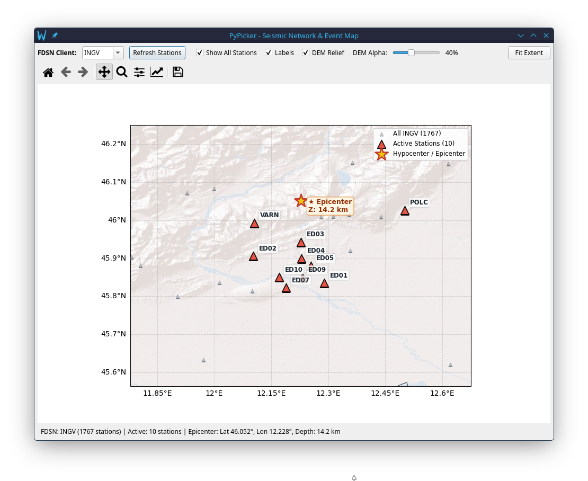

# Geographic Map Plugin: DEM, Seismic Stations & Epicenter

PyPicker includes an interactive **Geographic Map plugin** designed for spatial visualization of seismic networks, station distribution, and earthquake locations.

---

## 1. Overview & Key Capabilities

- **Cartographic Projection**: Powered by Cartopy with georeferenced coordinates and Natural Earth boundaries (national borders, coastlines, oceans, and lakes).
- **DEM with Shaded Relief in Transparency**: Displays worldwide topographic digital elevation hillshading (Esri World Shaded Relief / Natural Earth) with user-adjustable opacity (alpha slider).
- **FDSN Network Integration**: Automatically queries seismic station inventories from configured webservices (default: **INGV**, with support for IRIS, ETH, RESIF, USGS, etc.).
- **Smart Local Caching**: Downloads station inventories once and saves them to `~/.config/PyPicker/cache/stations_<CLIENT>.xml`, ensuring instant offline startup without repeated network requests.
- **Dual Station Display**:
  - **All Client Stations**: Displays all network stations as subtle background markers.
  - **Active Picker Stations**: Prominently highlights stations currently loaded in PyPicker with distinct colors and station code labels.
- **Automatic Coordinate Recovery**: Traces lacking SAC geographic coordinates (`stla`, `stlo`) are automatically matched by station code against the FDSN catalog and populated in memory.
- **Dynamic Epicenter Tracking**: The earthquake epicenter remains hidden until coordinates are provided or computed via the **Hypo71** localization solver (`L`), updating dynamically in real time.
- **Interactive Navigation**: Full pan, rectangular zoom, home reset, and mouse wheel zoom.

---

## 2. Launching the Map

You can open the map at any time:
- Press the **`M`** key on your keyboard.
- Or select **Plugins → Geographic Map (M)** from the top menu bar.

The map opens in a dedicated window, allowing side-by-side analysis with waveforms and the Hypo71 localization dialog.



---

## 3. Map Controls & Toolbar

The top control bar provides live adjustments:

| Control | Description |
|---|---|
| **FDSN Client** | Dropdown/editable field to select the data provider (default: `INGV`). |
| **Refresh Stations** | Forces a fresh download from the FDSN webservice and updates the local StationXML cache. |
| **Show All Stations** | Toggles visibility of background network stations. |
| **Labels** | Toggles text labels for active station codes. |
| **DEM Relief** | Enables or disables the topographic DEM hillshade layer. |
| **DEM Alpha** | Slider to adjust the DEM relief opacity from 5% to 100%. |
| **Fit Extent** | Automatically re-centers and zooms the map to tightly enclose loaded stations and the epicenter. |

### Navigation Toolbar
The bottom toolbar offers standard Matplotlib navigation tools:
- **Pan / Drag**: Click and drag with the left mouse button to move across the map.
- **Zoom to Rectangle**: Drag a box to magnify a specific region.
- **Mouse Wheel**: Scroll up to zoom in, scroll down to zoom out centered on the mouse cursor.
- **Home**: Resets to the initial bounding box.
- **Save Image**: Export publication-quality map figures in PNG, PDF, or SVG formats.

---

## 4. Configuration & Offline Cache

Settings for the map can be configured in [`config/config.json`](../config/config.json) or user overrides in `~/.config/PyPicker/config.json`:

```json
{
    "shortcuts": {
        "open_map": "M"
    },
    "defaults": {
        "station_client": "INGV",
        "map_dem_alpha": 0.40,
        "map_show_all_stations": true
    }
}
```

### Local StationXML Cache
- On the first query to a client (e.g. INGV), PyPicker downloads the full station catalog (~1700+ stations) and stores it at:
  ```
  ~/.config/PyPicker/cache/stations_INGV.xml
  ```
- Subsequent application launches immediately load this local file in `<0.05` seconds without internet traffic.
- Clicking **Refresh Stations** updates the cache file with the latest network additions.

---

## 5. Automatic Station Coordinate Recovery

Many seismic waveform files (especially raw SAC or converted MiniSEED traces) may lack station coordinate headers (`stla`, `stlo`, `stel`).

When files are opened:
1. PyPicker scans traces for missing or unset coordinates (`-12345.0`).
2. If coordinates are absent, PyPicker looks up `tr.stats.station` in the local FDSN catalog.
3. Matching coordinates (`stla`, `stlo`, `stel`) are automatically written to `tr.stats.sac` in memory.
4. **Original files on disk are not modified.** If the event is relocated with Hypo71, the complete georeferenced headers are automatically embedded into the newly saved files in `h71_localized/`.

---

## 6. Hypo71 Live Synergy

When you run [**Hypo71 earthquake location**](./hypo71_localization.md):
1. If the map window is open, the relocated epicenter (star marker ★) is updated on the map the instant the inversion converges.
2. The focal depth ($Z$) and origin time are annotated on the epicenter label.
3. Clicking **Apply to In-Memory Traces** in Hypo71 simultaneously updates theoretical arrival curves on the waveforms and confirms the epicenter position on the map.
