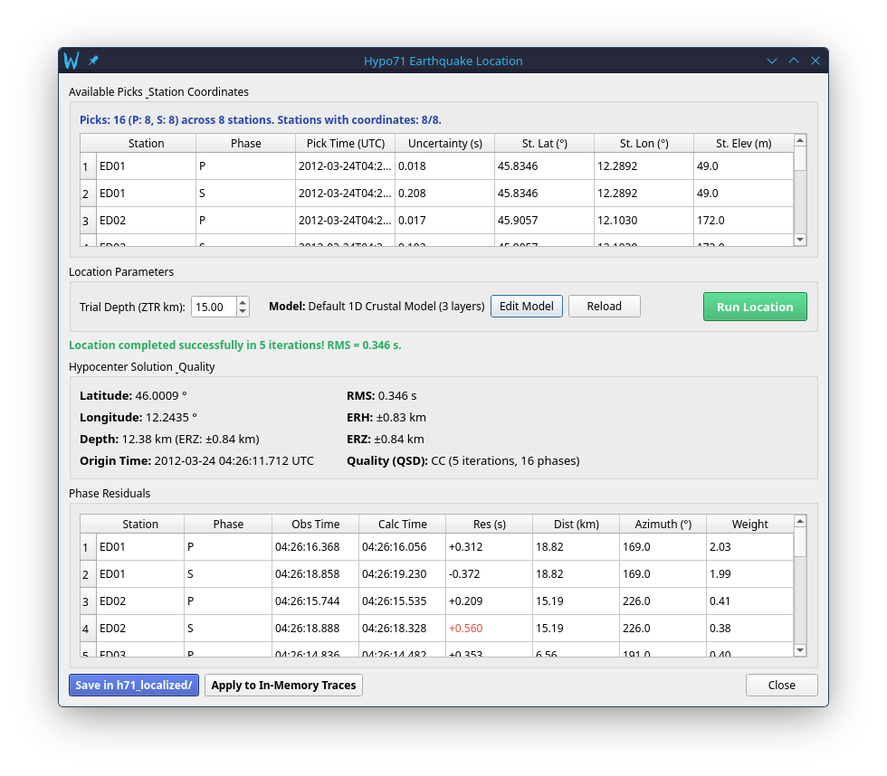

# Hypocentral Earthquake Location with Hypo71

PyPicker integrates the classical, USGS-standard **HYPO71** earthquake location algorithm (Lee & Lahr, 1972/1975) through the pure-Python [`hypo71py`](https://github.com/earthquake-research-group/hypo71py) solver. This guide details the mathematical principles, solver parameters, velocity model structure, solution quality metrics, and safe file export routines.

---

## 1. Principles & Mathematical Formulation

HYPO71 determines the origin time ($T_0$) and hypocentral coordinates ($X, Y, Z$) of a local earthquake by minimizing the travel-time residuals in a least-squares sense using **Geiger's method** (1912).

### The Travel-Time Equation
For station $i$ located at $(x_i, y_i, z_i)$, the observed arrival time $t_i$ of phase $k$ (P or S) is:
\[
t_i = T_0 + \tau_{i,k}(X, Y, Z) + \varepsilon_i
\]
where $\tau_{i,k}$ is the travel time through the 1D velocity model from hypocenter $(X, Y, Z)$ to station $(x_i, y_i, z_i)$, and $\varepsilon_i$ is the observational error.

### Linearization via Geiger's Method
Because $\tau_i$ is non-linear with respect to coordinates $(X, Y, Z)$, HYPO71 expands the equation into a first-order Taylor series around an initial **trial hypocenter** $(X_0, Y_0, Z_{TR}, T_0)$:
\[
t_i - t_{i,\text{calc}} \approx \Delta T_0 + \frac{\partial \tau_i}{\partial X}\Delta X + \frac{\partial \tau_i}{\partial Y}\Delta Y + \frac{\partial \tau_i}{\partial Z}\Delta Z
\]
In matrix notation, this forms an overdetermined linear system:
\[
\mathbf{A} \Delta \mathbf{m} = \mathbf{r}
\]
where:
- $\mathbf{A}$ is the matrix of partial derivatives (slowness vectors along the ray paths),
- $\Delta \mathbf{m} = [\Delta T_0, \Delta X, \Delta Y, \Delta Z]^T$ is the adjustment vector,
- $\mathbf{r}$ is the vector of travel-time residuals ($t_{\text{obs}} - t_{\text{calc}}$).

The system is weighted by phase pick uncertainties and epicentral distances, and solved iteratively using singular value decomposition or normal equations until the adjustments converge to zero.

---

## 2. Solver Parameters: Understanding Trial Depth ($Z_{TR}$)

In the **Location Parameters** box of the Hypo71 dialog, PyPicker prompts the user for **Trial Depth ($Z_{TR}$)**:

```text
Location Parameters
[ Trial Depth (ZTR km): [  5.0 ]  ]   [ Velocity Model: Default 1D Crustal Model ]
```

### What is Trial Depth ($Z_{TR}$)?
> [!IMPORTANT]
> **$Z_{TR}$ is the initial starting focal depth** where the iterative Geiger algorithm begins its search.
> 
> **It is NOT a displacement step or depth increment!** 
> The depth adjustment step $\Delta Z$ is calculated mathematically at each iteration from the travel-time residual equations.

### Why is $Z_{TR}$ Crucial?
In local earthquake location, the horizontal epicenter $(X, Y)$ is strongly constrained by station geometry and arrival azimuths. However, the focal depth ($Z$) and origin time ($T_0$) are strongly coupled (the $T_0 - Z$ trade-off):
- If all recording stations are distant ($R_{\text{epi}} > 2Z$), small variations in travel times can cause large fluctuations in focal depth.
- Choosing a trial depth reasonably close to the expected seismic zone ensures rapid convergence (typically 4–8 iterations) and avoids local minima or divergence into the atmosphere ("air quakes", $Z < 0$).

### Recommended $Z_{TR}$ Values

| Tectonic / Volcanic Context | Typical Depth Range | Recommended $Z_{TR}$ |
|---|---|---|
| **Caldera / Volcanic Seismicity** (e.g. Campi Flegrei, Vesuvius, Ischia) | 0.5 – 5.0 km | **3.0 km** |
| **Shallow Crustal Faults** (e.g. Central/Southern Apennines) | 5.0 – 15.0 km | **5.0 – 8.0 km** |
| **Regional / Deep Crustal Earthquakes** | 15.0 – 35.0 km | **10.0 – 15.0 km** |
| **Subduction / Intermediate-Depth Events** (e.g. Tyrrhenian Sea) | 50 – 300 km | **30.0 – 50.0 km** |

---

## 3. 1D Crustal Velocity Model (`velocity_model.json`)

The crustal structure is modeled as horizontal, flat, isotropic layers overlying a semi-infinite halfspace.

### File Format
The velocity structure is defined in [`config/velocity_model.json`](../config/velocity_model.json):

```json
{
  "name": "Default 1D Crustal Model",
  "layers": [
    {"depth_km": 0.0, "vp": 5.00, "vs": 2.89},
    {"depth_km": 11.1, "vp": 6.50, "vs": 3.75},
    {"depth_km": 38.0, "vp": 8.05, "vs": 4.65}
  ],
  "vp_vs_ratio": 1.73
}
```

- **`depth_km`**: Top boundary depth of the layer in kilometers ($0.0$ for surface).
- **`vp`**: P-wave velocity in km/s.
- **`vs`**: S-wave velocity in km/s. If set to `null` or omitted, it is automatically computed as `vp / vp_vs_ratio`.
- **`vp_vs_ratio`**: Global $V_p/V_s$ ratio (default: `1.73`).

### Stratigraphic Table for the Default Model

| Layer | Thickness (km) | Top Depth $z_{\text{top}}$ (km) | $V_p$ (km/s) | $V_s$ (km/s) |
|---|---|---|---|---|
| **1 (Upper Crust)** | 11.1 | 0.0 | 5.00 | 2.89 |
| **2 (Lower Crust)** | 26.9 | 11.1 | 6.50 | 3.75 |
| **Halfspace (Mantle)** | – | 38.0 | 8.05 | 4.65 |

### Shared Coherence with ObsPy TauP
A distinctive feature of PyPicker is **strict kinematic coherence**:
- `hypo71_plugin.py` converts `velocity_model.json` into a `CrustalVelocityModel` object for the flat-layer HYPO71 inversion.
- `picker_utils_qt.get_or_create_taup_model()` dynamically compiles the exact same layer specification into an ObsPy TauP model cached at `~/.config/PyPicker/cache/velocity_model.npz`.
- Consequently, theoretical arrival curves plotted on seismograms match the travel times computed by the hypocenter locator with 100% precision.

---

## 4. Prerequisites for Inversion

To perform an earthquake location:
1. **Waveforms loaded**: Waveforms must have station coordinates in their SAC headers (`stla`, `stlo`, `stel`).
   - If coordinates are missing, PyPicker's FDSN automatic recovery matches station codes against the INGV inventory and populates them in memory.
2. **Minimum Phase Picks**:
   - At least **4 arrival picks** (P and/or S).
   - At least **3 distinct recording stations** to resolve both horizontal coordinates and origin time.

---

## 5. Running the Location & Interpreting Results

### Workflow
1. Open the Hypo71 dialog by pressing **`L`** or selecting **Plugins → Localize with Hypo71 (L)**.
2. Review the detected arrival picks and station coordinates in the upper table.
3. Check or adjust the **Trial Depth ($Z_{TR}$)**.
4. Click **Run Location**.



### Quality Metrics & Statistical Significance

- **RMS (Root Mean Square Residual)**:
  \[
  \text{RMS} = \sqrt{\frac{\sum_{i=1}^{N} w_i^2 (t_{i,\text{obs}} - t_{i,\text{calc}})^2}{\sum_{i=1}^{N} w_i^2}}
  \]
  Values below `0.10 s` indicate excellent agreement between picks and the velocity model.
- **ERH (Horizontal Error)**: Standard error of the epicenter position in kilometers:
  \[
  \text{ERH} = \sqrt{\sigma_X^2 + \sigma_Y^2}
  \]
- **ERZ (Vertical Depth Error)**: Standard error of the focal depth in kilometers ($\sigma_Z$).
- **Quality Code (QSD)**: A two-letter classification assigned by HYPO71:
  - **First Letter (Statistical Fit)**:
    - **A**: $\text{RMS} < 0.15\text{ s}$, $\text{ERH} \le 1.0\text{ km}$, $\text{ERZ} \le 2.0\text{ km}$.
    - **B**: $\text{RMS} < 0.30\text{ s}$, $\text{ERH} \le 2.5\text{ km}$, $\text{ERZ} \le 5.0\text{ km}$.
    - **C**: $\text{RMS} < 0.50\text{ s}$, $\text{ERH} \le 5.0\text{ km}$.
    - **D**: Poor statistical fit or divergence.
  - **Second Letter (Station Geometry)**:
    - Evaluates the azimuthal distribution ($\text{GAP}$) and distance to the closest station ($D_{\text{MIN}}$ relative to depth $Z$).

### Phase Residuals Table
The lower table provides individual residuals for every arrival:
- **Observed Time**: Time recorded on the trace.
- **Calculated Time**: Predicted arrival time based on the inverted hypocenter.
- **Residual ($s$)**: $T_{\text{obs}} - T_{\text{calc}}$. Outliers ($|\text{Res}| > 0.5\text{ s}$) are highlighted in red to facilitate identifying pick errors.
- **Distance ($km$) & Azimuth ($^\circ$)**: Epicenter-to-station distance and direction.
- **Weight**: Inversion weight assigned by the solver.

---

## 6. Output Management & Trace Updating

### Saving Relocated Files (`Save in h71_localized/`)
Clicking **Save in h71_localized/**:
1. Creates a dedicated folder `h71_localized/` inside the parent directory of the original SAC files.
2. Saves relocated SAC traces with the suffix `_hypo71` (e.g., `trace_hypo71.sac`).
3. Updates all standard SAC event and distance headers:
   - `evla`, `evlo`, `evdp`: Relocated event coordinates and depth.
   - `o`: Origin time offset relative to trace start (`b`).
   - `dist`, `az`, `baz`, `gcarc`: Epicentral distance and azimuths calculated via WGS84 geodesic.
   - `stla`, `stlo`, `stel`: Station coordinates (if recovered via FDSN).
4. **Original files remain completely untouched.**

### Applying to In-Memory Traces (`Apply to In-Memory Traces`)
Clicking **Apply to In-Memory Traces**:
1. Updates `evla`, `evlo`, `evdp`, and `o` in the loaded stream in RAM.
2. Automatically enables **Show Arrivals** in the left sidebar.
3. Instantly recalculates and redraws theoretical arrival lines on all open seismograms.
4. Notifies the **Geographic Map** window (`M`) to immediately position or update the epicenter star.

### Automatic GIS Seismic Catalog (`seismic_catalog.txt`)
Whenever a hypocenter is computed:
1. PyPicker automatically logs the event to a tab-separated text table (`seismic_catalog.txt`, saved by default on the **Desktop** or at the path defined in `config.json`).
2. The catalog is pre-structured with 28 standardized columns (`Event_ID`, `Origin_Time_UTC`, `Latitude`, `Longitude`, `Depth_km`, `RMS_sec`, `ERH_km`, `ERZ_km`, `Quality_Loc`, etc.) for direct import into **QGIS**, **ArcGIS**, or Python/GMT as a delimited text point layer.
3. If an earthquake is re-localized with revised picks or a different velocity model, its existing row is updated in-place without duplicating records.
4. You can open and inspect the catalog at any time via **Plugins > Open Seismic Catalog (.txt)**.

---

## 7. References & Citations

If you use PyPicker's hypocentral location capabilities in scientific publications, please cite:

- **hypo71py**: Vanneste, K., & Sandiford, D. — *Python implementation of the HYPO71 earthquake location algorithm*. GitHub repository: [earthquake-research-group/hypo71py](https://github.com/earthquake-research-group/hypo71py).
- **HYPO71 Original Method**: Lee, W. H. K., & Lahr, J. C. (1972). *HYPO71: A computer program for determining hypocenter, magnitude, and first motion pattern of local earthquakes*. USGS Open-File Report 72-224.
- **Lee & Lahr (1975 revision)**: Lee, W. H. K., & Lahr, J. C. (1975). *HYPO71 (Revised): A computer program for determining hypocenter, magnitude, and first motion pattern of local earthquakes*. USGS Open-File Report 75-311.
- **ObsPy**: Beyreuther, M. et al. (2010). *ObsPy: A Python Toolbox for Seismology*. Seismological Research Letters, 81(3), 530–533. DOI: [10.1785/gssrl.81.3.530](https://doi.org/10.1785/gssrl.81.3.530).
