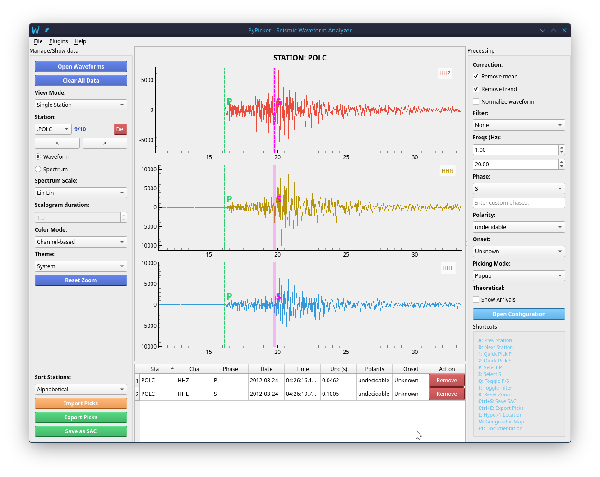

# Arrival Picking Guide

PyPicker enables rapid, accurate manual arrival picking with full metadata tracking, including phase types, uncertainty intervals, polarities, and onsets.

---

## 1. Placing Picks

### Mouse Picking Workflow
1. Select the target phase in the right sidebar (**P**, **S**, or **Custom**) or press:
   - `P`: select P phase
   - `S`: select S phase
   - `C`: select custom phase
   - `Q`: toggle between P and S
2. Position the mouse cursor on the waveform at the onset time.
3. Left-click and drag:
   - Horizontal movement sets the arrival time.
   - Vertical movement adjusts the width of the shaded uncertainty interval ($\pm \Delta t$).
4. Release the mouse button:
   - **In Popup Mode**: A dialog appears to confirm or adjust phase name, polarity (positive, negative, undecidable), and onset (impulsive, emergent, unknown).
   - **In Sidebar Mode**: The pick is recorded immediately using the active sidebar settings.

### Quick Key Picking (`1` and `2`)
- Hover your mouse over the trace at the arrival instant and press:
  - **`1`**: Places an instantaneous P pick at the exact mouse cursor position.
  - **`2`**: Places an instantaneous S pick at the exact mouse cursor position.

---

## 2. Pick Management & Interactive Table

The bottom-center panel contains the **Picks Table**:
- Displays Station, Channel, Phase, UTC Time, Uncertainty (s), Polarity, and Onset.
- Editing values directly in table cells dynamically updates the plotted vertical line markers and shaded intervals on the waveform plots.
- Click **Del** or select a row and delete to remove a pick.
- Click **Clear All Picks** to reset the pick list.

---

## 3. Station Sorting

Use the **Sort Stations** dropdown in the left sidebar to order stations:
- **Original**: Order in which waveforms were loaded.
- **Alphabetical**: Sorted by station code name.
- **By Distance**: Sorted by epicentral distance (requires SAC station coordinates `stla`, `stlo` and event coordinates `evla`, `evlo`).
- **By P/S Arrival**: Sorted chronologically by the earliest picked arrival on each station.

---

## 4. Import, Export, and SAC Header Writing

### Importing Existing Picks
- Click **Import Picks** (`Ctrl+I`) to load picks from:
  - **CSV**: Semicolon-delimited format (`Station;Channel;Phase;UTC_Time;Uncertainty_sec;Polarity;Onset`).
  - **QuakeML**: Standard seismological XML schema (`.qml` or `.xml`).
  - **SeisGram2K**: Standard `.pick` text files.

### Exporting Picks
- Click **Export Picks** (`Ctrl+E`):
  - Choose between **CSV** or **QuakeML**.

### Writing to SAC Headers
- Click **Save SAC** (`Ctrl+S`) or select **File → Save SAC...**:
  - Automatically writes the picks directly into the corresponding SAC header variables:
    - P phase: `a` (arrival time in seconds from file start), `ka` (string `"P"`), `f` (uncertainty in seconds).
    - S phase: `t0` (arrival time), `kt0` (string `"S"`), `resp0` (uncertainty).
    - Custom phases: mapped to `t1`–`t9`, `kt1`–`kt9`, `resp1`–`resp9`.
  - Clears old markers so deleted picks are also removed from the SAC files.
  - **Caution**: Ensure you keep backups of your original SAC files before saving, or use the dedicated Hypo71 export workflow to write to `h71_localized/` without touching originals.
